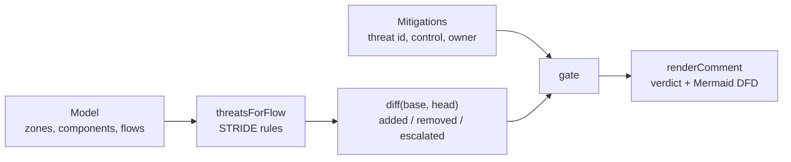

# stridediff

Architecture as typed data with a STRIDE threat delta for every change: new, removed and worsened threats between two versions of a model, and a gate that fails on new risk with no recorded mitigation.

[](https://github.com/SlateGitOrg/stridediff/actions/workflows/ci.yml)

## Why

Threat models are written once during design review, then the architecture changes forty times and the document is never touched. Security review turns into a calendar event: it happens when nothing is being built, and building happens when nobody is reviewing. stridediff makes the review a property of the change. A review comment like "this change adds an unauthenticated flow crossing the internet boundary carrying PII" is something a pull request can carry; a 40-page PDF is not.

## Features

- Architecture model with zones (trust boundaries), components, data flows, data classification and recorded mitigations.
- STRIDE rule engine that derives threats per flow from explicit conditions, rather than emitting all six categories everywhere.
- Diff engine that reports added, removed, escalated (same threat, higher severity) and unchanged threats.
- Gate that fails on new or escalated threats with no mitigation, and passes when each carries a control and a named owner.
- Pull-request comment renderer with the verdict, a table of offending flows and an embedded Mermaid data-flow diagram that marks boundary crossings.

## Architecture



A `Model` is plain TypeScript data. `threatsForFlow` applies the rules to each flow, `diff` compares the threat registers of two model versions by id and severity, and `gate` checks every added or escalated threat against the head model's mitigations. `renderComment` turns the result into Markdown. See [docs/ARCHITECTURE.md](docs/ARCHITECTURE.md).

## Quick start

Requires Node 22.18 or newer (TypeScript runs natively through type stripping). There is no build step and no dependencies to install.

```bash
git clone https://github.com/SlateGitOrg/stridediff.git
cd stridediff
npm test        # 24 tests
npm run demo    # mutation table + the pull-request comment
```

On Node 22.6 to 22.17, prefix the commands with `NODE_OPTIONS=--experimental-strip-types`.

## Usage

The demo diffs a payments baseline (`browser -> edge -> api -> ledger_db` across `internet`, `dmz` and `core` zones) against eight mutations:

```
  change                                              new   worse  gate
  no change                                           0     0      PASS
  add an internal flow that stays inside core         0     0      PASS
  expose an unauthenticated webhook from the internet 3     0      FAIL
  the same webhook, with mitigations recorded         3     0      PASS
  downgrade an internal hop to plaintext http         1     1      FAIL
  expose the database directly to the dmz             4     0      FAIL
  add a component that does not keep an audit trail   1     0      FAIL
  remove the plaintext hop again                      0     0      PASS
```

The comment for the webhook change:

```
### Threat model delta

**FAIL** - 3 new threat(s) with no mitigation.

| flow | threat | severity | why |
|---|---|---|---|
| `f5` | Spoofing | high | unauthenticated flow crosses a trust boundary - the caller is whoever claims to be the caller |
| `f5` | InformationDisclosure | medium | pii leaves its trust zone; encrypted in transit, but the receiving zone now holds it |
| `f5` | DenialOfService | medium | externally reachable process with no rate limit |
```

From code:

```ts
import { gate, renderComment } from './src/model.ts';
import { BASE, MUTATIONS } from './src/fixtures.ts';

const result = gate(BASE, MUTATIONS[2]!.model);
console.log(result.passed, result.unmitigated.map((t) => t.id));
console.log(renderComment(BASE, MUTATIONS[2]!.model));
```

## How it works

- **Rules.** Spoofing: an unauthenticated flow crosses a boundary. Tampering: an unencrypted protocol crosses a boundary. Information disclosure: sensitive data (`pii`, `secret`) crosses a boundary, with higher severity when unencrypted. Repudiation: the target keeps no audit trail for non-public data. Denial of service: an externally reachable process with no rate limit. Elevation of privilege: unauthenticated access to a datastore across a boundary.
- **Escalation.** Downgrading `edge -> api` from `grpc-tls` to `http` adds one new threat and raises an existing information-disclosure threat from medium to high. An id-only diff would call that change harmless, so severity increases are reported and gated like new threats.
- **Gate scope.** Only new or escalated threats count. Pre-existing threats never fail a pull request, which keeps the gate from being switched off.
- **Mitigations** are keyed `flowId:Category` and carry a control and an owner.

## Testing

```bash
npm test
```

`tests/delta.test.ts` asserts the exact expected threat delta for each fixture mutation, that unmitigated new threats fail the gate, that a recorded mitigation does not, that pre-existing threats never fail it, that escalations are caught and gated, the individual derivation rules, and the contents of the rendered comment.

## Project layout

```
src/model.ts      model types, STRIDE rules, diff, gate, comment + Mermaid renderer
src/fixtures.ts   baseline architecture and mutations with expected deltas
src/demo.ts       demo script
tests/            delta, gate, rule and rendering tests
docs/             architecture notes
```

## Limitations

- The model is TypeScript data; there is no YAML loader, CLI or GitHub Action yet.
- Rules are deliberately narrow and heuristic. stridediff surfaces questions for a reviewer; it is not an automated security review.
- A recorded mitigation satisfies the gate; it does not judge whether the control is adequate.

## License

MIT — see [LICENSE](LICENSE).
