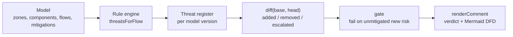

# Architecture

## Context

Threat models are usually written once during design review and then drift as
the architecture changes. stridediff keeps the model as typed data next to the
code, derives STRIDE threats from it with explicit rules, and reviews the
difference between two versions of the model instead of the whole document.

## Components

All of it lives in `src/model.ts`; `src/fixtures.ts` holds the baseline payments
architecture and the mutations used by the tests and the demo.

## Key decisions

- **Narrow rules, not all six categories per flow.** Emitting every STRIDE
  category for every flow is defensible but produces a uniform wall of threats
  that says nothing about which change made things worse. Each category fires
  only on a concrete condition (unauthenticated boundary crossing, plaintext
  across a boundary, no audit trail on the target, no rate limit on an exposed
  process, unauthenticated datastore access).
- **The unit of review is the delta.** `diff` compares threat ids between
  versions and reports added, removed, escalated and unchanged threats.
- **Escalation is a first-class result.** Downgrading a hop from TLS to
  plaintext adds no new threat id when PII was already leaving its zone, but it
  raises the severity from medium to high. An id-only diff would report that
  change as harmless, so severity increases are tracked and gated like new
  threats.
- **The gate fails only on new, unmitigated risk.** Pre-existing threats are not
  the business of the pull request; failing on them makes every change
  unmergeable and gets the gate disabled. A threat with a recorded mitigation
  (`flowId:Category`, control, owner) passes.
- **The comment explains itself.** The verdict, the offending flows with their
  rationale, the recorded mitigations and a generated data-flow diagram are all
  in one Markdown comment, with trust-boundary crossings drawn as thick arrows.

## Failure modes

- A flow that references an unknown component is treated as not crossing a
  boundary, so it produces no boundary threats. The model is not schema
  validated.
- Mitigations are matched by exact threat id. A renamed flow orphans its
  mitigation and the gate fails, which is the safe direction.

## Out of scope

- Reading a model from YAML, a CLI and a CI action. The model is TypeScript
  data and the gate is a library function.
- Judging whether a mitigation is adequate. A recorded owner and control satisfy
  the gate; a human decides whether the control is good.
